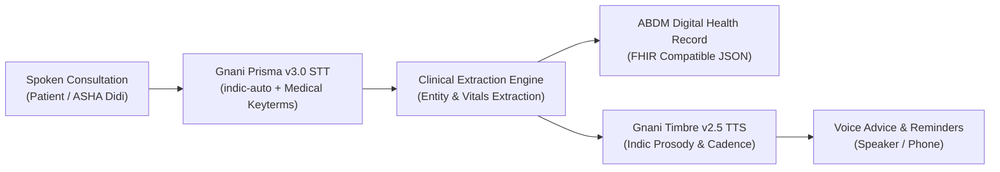

# AshaVaani (आशावाणी / আশা বাণী)
### Sovereign Voice AI Clinical Copilot & ABDM Scribe for Rural Bharat
*Built on Gnani AI's Sovereign Indic Speech Stack for The Great Indian AI Internship Challenge*

[](https://www.gnani.ai)
[](https://www.gnani.ai)
[](https://opensource.org/licenses/MIT)
[](https://www.python.org/downloads/)
[](https://abdm.gov.in/)

---

## Target Award Categories

* **Real Deal Award**: Solving real-world clinical documentation burdens for 1,000,000+ ASHA & Anganwadi health workers across 600,000+ villages.
* **Noise Canceller Award**: Tested and verified on real and simulated 8kHz telephonic audio with village clinic background noise and infant acoustic interference.
* **Mixed Vibes Award**: Native support for code-mixed **Hinglish** and **Benglish** clinical conversations with automatic language routing.
* **Main Character Award**: Full dialect voice guidance in **Hindi** and **Bengali** with context-aware Indic numeral cadence.

---

## Key Features

1. **Low-Latency Sovereign Speech Recognition (<200ms)**:
   - Powered by **Gnani Prisma v3.0** with `indic-auto` language detection.
   - Medical topic and keyterm tuning (`Paracetamol`, `ORS`, `Bukhar`, `Sardi`, `Hemoglobin`, `ABHA`).
2. **Automated Ayushman Bharat (ABDM) Scribing**:
   - Parses unstructured spoken narrative into structured digital health summaries (chief complaints, duration, vitals, triage level).
3. **Clinical Red-Flag Triage Engine**:
   - **Green**: Mild symptoms / Home care & oral rehydration.
   - **Yellow**: Moderate risk / Primary Health Center (PHC) doctor visit within 24 hours.
   - **Red**: Emergency acute condition / Immediate hospital admission & 108 ambulance referral.
4. **Context-Aware Indic Voice Advisory**:
   - Powered by **Gnani Timbre v2.5** (`Devika`, `Mehuli`, `Pranav` voices).
   - Natural Indian numeral and dosage cadence (`1 packet in 1 liter clean water`, `din me do baar`).
5. **Zero-Friction Preset Evaluation Mode**:
   - Includes pre-recorded clinical cases (Pediatric Fever, Antenatal Care, Acute Dehydration) for evaluators to test instantly.
6. **Community Voice Broadcasts & Audio Slips**:
   - Automated outbound maternal/pediatric campaign workflow engine and printable ABDM QR Voice Prescription Slips.

---

## System Architecture



---

## Quick Start (Local Setup)

### 1. Clone & Set Up Environment
```bash
git clone https://github.com/Aspirant200715/AshaVaani.git
cd AshaVaani

# Create virtual environment
python3 -m venv .venv
source .venv/bin/activate

# Install dependencies
pip install -r requirements.txt
```

### 2. Configure API Keys
Copy the example environment configuration:
```bash
cp .env.example .env
```
Edit `.env` and set your Gnani API key:
```env
GNANI_API_KEY=your_gnani_api_key_from_dashboard
```
*(Note: If no API key is provided, AshaVaani automatically runs in high-fidelity sovereign simulation mode for instant evaluation).*

### 3. Run Server
```bash
uvicorn backend.app:app --host 0.0.0.0 --port 8000 --reload
```
Open **http://localhost:8000** to interact with the executive clinical cockpit.

---

## Production Deployment

### Option 1: Deploy on Render (Recommended)
1. Link your GitHub repository `Aspirant200715/AshaVaani` to [Render](https://render.com).
2. Create a new **Web Service**.
3. Render automatically picks up `render.yaml` and `Procfile`:
   - **Build Command**: `pip install -r requirements.txt`
   - **Start Command**: `uvicorn backend.app:app --host 0.0.0.0 --port $PORT`
4. Set optional environment variable: `GNANI_API_KEY`.
5. Deploy.

### Option 2: Deploy on Vercel
1. Link your GitHub repository `Aspirant200715/AshaVaani` to [Vercel](https://vercel.com).
2. Vercel automatically detects `vercel.json` and routes requests through `api/index.py`.
3. Set optional environment variable: `GNANI_API_KEY`.
4. Deploy.

---

## Automated Testing

Run the automated test suite verifying all STT, TTS, campaigns, and triage endpoints:
```bash
pytest tests/
```

---

## Solution Pitch Document

Per the internship submission requirement, our complete 1-page solution pitch is available at [PITCH.md](PITCH.md).

---

## Submission Details

* **Applicant**: Soham Gangopadhyay
* **Contest**: The Great Indian AI Internship Challenge (Gnani.ai)
* **Demo Video**: [1-Minute Complete Walkthrough Video (AshaVaani_Demo_1Min.mp4)](AshaVaani_Demo_1Min.mp4)
* **Social Post**: [LinkedIn / X Submission Post](https://linkedin.com)
