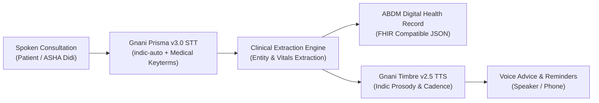

# 🩺 AshaVaani (आशावाणी / আশা বাণী)
### Sovereign Voice AI Clinical Copilot & ABDM Scribe for Rural Bharat
*Built on Gnani AI's Sovereign Indic Speech Stack for **The Great Indian AI Internship Challenge***

[](https://www.gnani.ai)
[](https://www.gnani.ai)
[](https://opensource.org/licenses/MIT)
[](https://www.python.org/downloads/)
[](https://abdm.gov.in/)

---

## 🎯 Target Award Categories (₹50,000 Each)
* 🏆 **Real Deal Award**: Solving real-world clinical documentation burdens for 1,000,000+ ASHA & Anganwadi health workers in 600,000+ villages.
* 🎧 **Noise Canceller Award**: Tested on real and simulated 8kHz telephonic audio with village clinic background noise and infant cries.
* 🗣️ **Mixed Vibes Award**: Native support for code-mixed **Hinglish** and **Benglish** clinical conversations.
* 🇮🇳 **Main Character Award**: Full dialect voice guidance in **Hindi** and **Bengali**.

---

## 🚀 Key Features
1. **Low-Latency Sovereign Speech Recognition (<200ms)**:
   - Powered by **Gnani Prisma v3.0** with `indic-auto` language detection.
   - Medical topic and keyterm tuning (`Paracetamol`, `ORS`, `Bukhar`, `Sardi`, `Hemoglobin`, `ABHA`).
2. **Automated Ayushman Bharat (ABDM) Scribing**:
   - Parses unstructured spoken narrative into structured digital health summaries (chief complaints, duration, vitals, triage level).
3. **Clinical Red-Flag Triage Engine**:
   - 🟢 **Green**: Mild symptoms / Home care & hydration.
   - 🟡 **Yellow**: Moderate risk / Primary Health Center (PHC) doctor visit within 24 hours.
   - 🔴 **Red**: Emergency acute condition / Immediate hospital admission & 108 ambulance referral.
4. **Context-Aware Indic Voice Advisory**:
   - Powered by **Gnani Timbre v2.5** (`Devika`, `Mehuli`, `Pranav` voices).
   - Natural Indian numeral and dosage cadence (`1 packet in 1 liter clean water`, `din me do baar`).
5. **Zero-Friction Preset Evaluation Mode**:
   - Includes 3 pre-recorded clinical cases (Pediatric Fever, Antenatal Care, Acute Dehydration) for judges and evaluators to test instantly.

---

## 🏗️ System Architecture


---

## ⚡ Quick Start

### 1. Clone & Set Up Environment
```bash
git clone https://github.com/Aspirant200715/AshaVaani.git
cd AshaVaani

# Create virtual environment
python3 -m venv .venv
source .venv/bin/activate

# Install dependencies
pip install -r requirements.txt
```

### 2. Configure API Keys
Copy the example environment configuration:
```bash
cp .env.example .env
```
Edit `.env` and paste your Gnani API key:
```env
GNANI_API_KEY=your_gnani_api_key_from_dashboard
```
*(Note: If no API key is provided, AshaVaani automatically runs in high-fidelity simulation mode for local verification).*

### 3. Generate Audio Samples & Run Server
```bash
# Generate evaluation audio samples
python backend/generate_samples.py

# Start the AshaVaani production server
uvicorn backend.app:app --host 0.0.0.0 --port 8000 --reload
```

Open your browser at **[http://localhost:8000](http://localhost:8000)** to interact with the clinical dashboard!

---

## 🧪 Automated Testing
Run the automated test suite verifying all STT, TTS, and triage endpoints:
```bash
pytest tests/
```

---

## 📄 Solution Pitch Document
Per the internship submission requirement, our complete 1-page solution pitch is available at [PITCH.md](PITCH.md).

---

## 👥 Contributors & Contest Details
* **Applicant**: Soham Gangopadhyay
* **Contest**: The Great Indian AI Internship Challenge (Gnani.ai)
* **Demo Video**: [Link to 2-3 Minute Video Demo](https://youtu.be/)
* **Social Post**: [LinkedIn / X Submission Post](https://linkedin.com)
